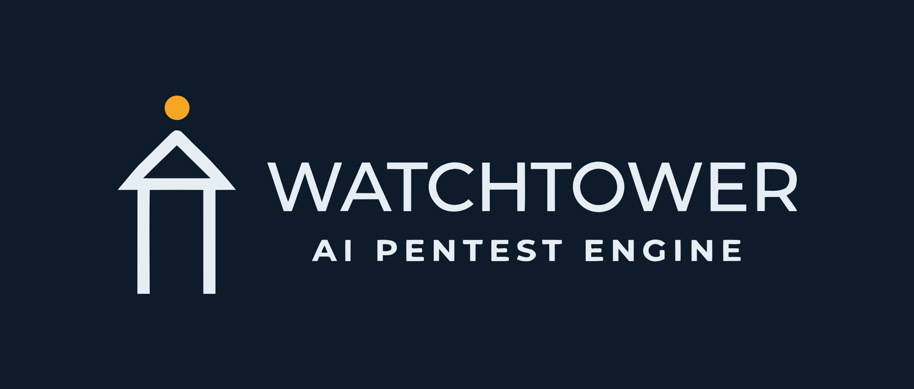

<div align="center">



# Watchtower

**AI-powered penetration testing automation, orchestrated by LLM agents.**

[](https://opensource.org/licenses/MIT)
[](https://www.python.org/downloads/)
[](https://langchain-ai.github.io/langgraph/)
[]()

[Quick Start](#quick-start) ·
[Features](#features) ·
[Usage](#usage) ·
[Configuration](#configuration) ·
[Custom Providers](#custom-providers) ·
[Troubleshooting](#troubleshooting)

</div>

---

**Watchtower** is a simple AI-powered penetration testing automation CLI that uses LLMs and [LangGraph](https://langchain-ai.github.io/langgraph/) to orchestrate agentic workflows against your own websites, then turns the results into useful pentest reports.

> [!WARNING]
> Penetration testing is a red-team activity and must only be performed with explicit permission. See the [Legal Disclaimer](#legal-disclaimer) before you begin.

## Table of Contents

- [Features](#features)
- [Quick Start](#quick-start)
  - [Prerequisites](#prerequisites)
  - [Installation](#installation)
  - [Configuration](#configuration)
- [Usage](#usage)
  - [Interactive tool selection](#interactive-tool-selection)
  - [Headless mode](#headless-mode)
  - [Authenticated pentesting](#authenticated-pentesting)
- [Custom Providers](#custom-providers)
- [Reports](#reports)
- [Roadmap](#roadmap)
- [Important Notes](#important-notes)
- [Troubleshooting](#troubleshooting)
- [Contributing](#contributing)
- [Security](#security)
- [License](#license)
- [Legal Disclaimer](#legal-disclaimer)
- [Acknowledgements](#acknowledgements)

## Features

- **Multi-agent architecture**: a team of specialized agents reasons through the engagement:
  - `Planner`: analyzes the target and current findings to strategize the next sequence of actions.
  - `Worker`: dynamically executes the tools requested by the Planner.
  - `Analyst`: parses tool `stdout`/`stderr`, filters false positives, and converts raw output into structured findings.
- **Dynamic tool arsenal**: 23 security tools integrated via Python subprocess wrappers. The interactive CLI auto-checks your `PATH` and lets you exclude tools on the fly:
  - *Network*: `nmap`, `masscan`
  - *Web recon*: `httpx`, `whatweb`, `wafw00f`
  - *Subdomain / DNS*: `subfinder`, `amass`, `dnsrecon`
  - *Vulnerability*: `nuclei`, `nikto`, `sqlmap`, `wpscan`, `retire.js`
  - *SSL/TLS*: `testssl.sh`, `sslyze`
  - *Content / params*: `gobuster`, `ffuf`, `arjun`, `kiterunner`
  - *Security analysis*: `xsstrike`, `gitleaks`, `cmseek`, `dalfox`
- **State management**: uses local `SQLite` to store a historical record of observations and findings.
- **Parallel reconnaissance**: orchestrates multiple tools concurrently (e.g. `httpx` + `whatweb`) to accelerate assessment cycles.
- **Smart truncation**: output-aware clipping that prioritizes security vulnerabilities and critical findings over generic logs.
- **LLM-agnostic**: swap between OpenAI, Google Gemini, OpenRouter, and dozens of other providers via `.env` or CLI flags.

## Quick Start

### Prerequisites

- **OS**: Linux or macOS recommended (Windows is supported via WSL2 for some networking tools).
- **Python**: 3.11 or newer.
- **API key**: an active key for OpenRouter, OpenAI, or Gemini.

To use the AI's full capabilities, the actual tool binaries (`nmap`, `nuclei`, `httpx`, …) must be installed and available on your `PATH`. Watchtower automatically detects which tools are missing and skips them in the UI.

Install all supported tools with the bundled script:

```sh
./install_tools.sh   # or with sudo
```

### Installation

```bash
git clone https://github.com/fzn0x/watchtower.git
cd watchtower

python -m venv venv
source venv/bin/activate   # On Windows: venv\Scripts\activate
pip install -r requirements.txt
```

### Configuration

```bash
cp .env.example .env
```

Populate `.env` with your API keys. You only need **one** of the following:

```ini
OPENAI_API_KEY=""
GEMINI_API_KEY=""
OPENROUTER_API_KEY=""
```

Optionally, override which model each provider uses. Sensible defaults are already configured:

```ini
OPENAI_MODEL_NAME="gpt-4-turbo"
GEMINI_MODEL_NAME="gemini-1.5-pro"
OPENROUTER_MODEL_NAME="anthropic/claude-3-opus"
```

## Usage

Specify a target URL or IP with the `-t` / `--target` flag:

```bash
python -m watchtower.main -t https://www.example.com
```

### Interactive tool selection

On launch, Watchtower shows an interactive checklist and highlights which of the 23 tools are installed on your machine. Use `<Space>` to toggle individual tools (narrowing the LLM's arsenal) and `<Enter>` to confirm.

### Headless mode

To skip the interactive menu (e.g. in a CI/CD pipeline), use `--skip-ask-tools` to auto-run with everything available on your `PATH`:

```bash
python -m watchtower.main -t https://www.example.com --skip-ask-tools
```

### Authenticated pentesting

Watchtower supports authenticated workflows via session cookies or custom headers:

```bash
python -m watchtower.main -t https://api.example.com \
  --cookie "session=xyz123" \
  --header "X-API-Key: secret-key"
```

## Custom Providers

Watchtower supports almost any LLM provider via LangChain and LiteLLM integrations. Override the defaults from the CLI with `--provider`, `--model`, and `--apikey`:

```bash
python -m watchtower.main -t https://www.example.com \
  --provider=https://api.dgrid.ai/api/v1 \
  --model=anthropic/claude-opus-4.5 \
  --apikey "API_KEY"
```

Example output (using the `httpx` tool):

```text
INFO: ==> Node Executed: [WORKER]
INFO: HTTP Request: POST https://api.dgrid.ai/api/v1/chat/completions "HTTP/1.1 200 OK"
INFO: ==> Node Executed: [ANALYST]
INFO:     - Updated state 'findings': [{'title': 'Overly Permissive CORS Configuration', 'severity': 'Medium', ...}, {'title': 'Missing Security Headers', 'severity': 'Low', ...}]
```

> [!IMPORTANT]
> The `--apikey` argument takes the **name** of the variable stored in your `.env` file (e.g. `MY_GROQ_KEY`), *not* the raw API key string. This keeps your secrets out of your shell history.

**Supported providers include:**

Anthropic · OpenAI · OpenRouter · LiteLLM · Amazon Bedrock · Vercel AI Gateway · Moonshot AI · Mistral · MiniMax · OpenCode Zen · GLM Models · Z.AI · Synthetic · Qianfan, plus **any custom HTTP endpoint** (used as a drop-in OpenAI-compatible endpoint via LangChain's `ChatOpenAI` client).

See the full list at [docs.litellm.ai/docs/providers](https://docs.litellm.ai/docs/providers).

## Reports

Watchtower stores every executed command, terminal output, and confirmed vulnerability in a local SQLite memory file (`pentest_memory.db`).

Export all findings to a cleanly formatted PDF without re-running the pentest:

```bash
python -m watchtower.main --report "pentest_report.pdf"
```

<div align="center">
  
</div>

## Roadmap

- [x] Initial LangGraph Planner/Worker architecture.
- [x] Integrate core web and network reconnaissance tools.
- [x] Add Pydantic structured-output fallback for open-source OpenRouter models.
- [x] Parallel tool execution and smart truncation.
- [x] Support for authenticated pentesting (cookies / headers).
- [ ] Advanced business-logic analysis enhancements.

## Important Notes

- **API costs**: the multi-agent workflow consumes tokens rapidly during active scanning as the Planner loops through observations. Be mindful of your API budget.
- **Hallucinations**: while the Analyst agent filters false positives, LLMs can still draw wrong conclusions from ambiguous tool output. **Always manually verify findings.**
- **Network stability**: some tools (`masscan`, `ffuf`) are extremely noisy and may trip upstream edge protections (e.g. Cloudflare), polluting the observation logs with `403`s.

## Troubleshooting

### `model: [model_name] does not support feature: structured-outputs`

This occurs with experimental, free, or unsupported models on OpenRouter (e.g. some Qwen or DeepSeek variants). Watchtower relies on LangChain's Structured Outputs to force well-formed JSON. Switch `OPENROUTER_MODEL_NAME` in `.env` to a fully supported model, such as:

- `anthropic/claude-3.5-sonnet`
- `openai/gpt-4o`
- `google/gemini-1.5-pro`
- `meta-llama/llama-3.1-70b-instruct`

> Watchtower includes a string-fallback parser for models without native structured-output support, but commercial models yield significantly better pentesting logic.

### `429 Too Many Requests: [model]:free is temporarily rate-limited upstream`

You are using a `:free` model tier on OpenRouter and the upstream providers are rate-limiting free traffic. Wait out the timeout or switch to a different (or paid) model endpoint.

## Contributing

Contributions are welcome! See [CONTRIBUTING.md](CONTRIBUTING.md) for development setup and guidelines on adding new tools and agents.

Please do not remove any guardrails that prevent out-of-scope testing.

## Security

Found a security issue? Please review our [Security Policy](SECURITY.md) for responsible disclosure instructions.

## License

Licensed under the **MIT License**. See [`LICENSE`](LICENSE) for details.

By using this software, you agree to the conditions outlined in the [Legal Disclaimer](#legal-disclaimer). Watchtower's developers assume no liability for misuse of this tool.

## Legal Disclaimer

**Watchtower is designed exclusively for authorized security testing and educational purposes.**

- **Legal use:** authorized penetration testing, security research, educational environments.
- **Illegal use:** unauthorized access, malicious activity, any form of cyber attack.

You are fully responsible for ensuring you have explicit written permission before testing any system. Unauthorized access to computer systems is illegal under laws including the Computer Fraud and Abuse Act (CFAA), GDPR, and equivalent international legislation.

By using Watchtower, you agree to use it only on systems you own or are explicitly authorized to test.

## Acknowledgements

Created and maintained by **[fzn0x](https://github.com/fzn0x)**.

A deep and sincere thank you to the open-source security community. Watchtower stands on the shoulders of giants. This framework would not exist without the developers who built and maintain the underlying penetration testing and reconnaissance tools that power its worker engine. Thank you for making security accessible.
