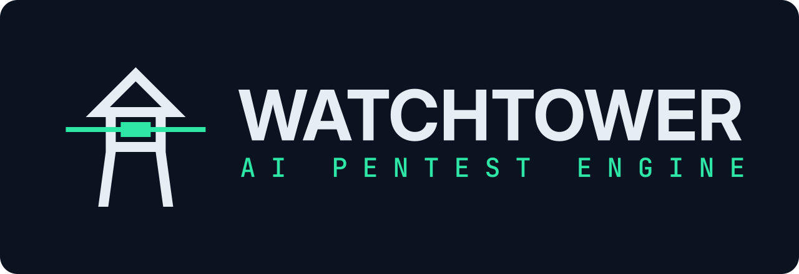

<div align="center">



# Watchtower

**AI-powered penetration testing automation, orchestrated by LLM agents.**

[](https://github.com/fzn0x/watchtower/actions/workflows/ci.yml)
[](https://fzn0x.github.io/watchtower/)
[](https://opensource.org/licenses/MIT)
[](https://www.python.org/downloads/)
[](https://langchain-ai.github.io/langgraph/)
[]()

[Documentation](https://fzn0x.github.io/watchtower/) ·
[Quick Start](#quick-start) ·
[Models](#models) ·
[Tools](https://fzn0x.github.io/watchtower/tools/) ·
[Troubleshooting](https://fzn0x.github.io/watchtower/troubleshooting/)

</div>

---

**Watchtower** is an AI-powered penetration testing automation CLI that uses LLMs and [LangGraph](https://langchain-ai.github.io/langgraph/) to orchestrate agentic workflows against your own websites, then turns the results into useful pentest reports.

> [!WARNING]
> Penetration testing is a red-team activity and must only be performed with explicit permission. See the [Legal Disclaimer](#legal-disclaimer) before you begin.

## Features

- **Multi-agent architecture**: a Planner picks the next tools, a Worker runs them (in parallel when asked), an Analyst turns every tool's output into structured findings, and a Logic Analyst looks for business-logic and IDOR risk.
- **28 integrated security tools** across network, web recon, crawling and URL discovery, DNS, vulnerability, TLS, content discovery, and secret scanning. See [Tools](https://fzn0x.github.io/watchtower/tools/).
- **Parallel reconnaissance** and **smart truncation** of long tool output.
- **Run history in SQLite** with per-run PDF reports.
- **LLM-agnostic**: OpenAI, Gemini, OpenRouter, Claude (API key or `ant auth login`), LiteLLM, any OpenAI-compatible endpoint, or local models through Ollama, LM Studio, llama.cpp, and vLLM, with opt-in flagship models and reasoning controls.

## Quick Start

Requires Python 3.10+ and, for the tools, Linux or macOS (Windows through WSL2).

```bash
git clone https://github.com/fzn0x/watchtower.git
cd watchtower

sudo ./install_tools.sh          # installs the security tools
python -m venv venv
source venv/bin/activate         # On Windows: venv\Scripts\activate
pip install -r requirements.txt

cp .env.example .env             # then set a provider key, or see Models below
python -m watchtower.main -t https://www.example.com
```

Export the latest run as a PDF with `python -m watchtower.main --report pentest_report.pdf`.

## Models

Watchtower runs on hosted models or on a model on your own machine.

### Claude

Set `ANTHROPIC_API_KEY` in `.env`, or sign in once with the [Anthropic CLI](https://github.com/anthropics/anthropic-cli) and skip the key:

```bash
ant auth login
python -m watchtower.main -t https://www.example.com
```

Watchtower uses the Anthropic SDK's own sign-in, so `ANTHROPIC_AUTH_TOKEN` (for a gateway or proxy) and workload identity federation (for CI) work too. The default model is `claude-sonnet-5-5`, and `--flagship` switches to `claude-opus-5-5`. Claude Pro and Max subscriptions cannot be used: Anthropic does not allow third-party tools to offer claude.ai login.

### Ollama and other local models

Run the model locally, so prompts and findings never leave your machine:

```bash
ollama pull llama3.3
python -m watchtower.main -t https://www.example.com --provider ollama --model llama3.3
```

No API key is needed. Set `OLLAMA_BASE_URL` if Ollama is not at `localhost:11434`, for example when Watchtower runs in Docker. LM Studio, llama.cpp, vLLM, and other OpenAI-compatible servers work by URL: `--provider http://localhost:1234/v1 --model <name>`. Give the model a large enough context window; see [Local models](https://fzn0x.github.io/watchtower/providers/#local-models).

OpenAI, Gemini, OpenRouter, LiteLLM, and custom endpoints are covered in [LLM providers](https://fzn0x.github.io/watchtower/providers/).

## Documentation

The full documentation lives at **[fzn0x.github.io/watchtower](https://fzn0x.github.io/watchtower/)**:

- [Getting started](https://fzn0x.github.io/watchtower/getting-started/): installation, configuration, Docker
- [Usage](https://fzn0x.github.io/watchtower/usage/): interactive and headless runs, authenticated testing, flagship models and reasoning
- [LLM providers](https://fzn0x.github.io/watchtower/providers/): built-in providers, Claude sign-in, local models, and custom endpoints
- [Tools](https://fzn0x.github.io/watchtower/tools/): every integrated tool and the command Watchtower runs
- [Reports](https://fzn0x.github.io/watchtower/reports/): run history and PDF export
- [Troubleshooting](https://fzn0x.github.io/watchtower/troubleshooting/)
- [Development](https://fzn0x.github.io/watchtower/development/): adding tools and agents, CI, releases

## Roadmap

- [x] Initial LangGraph Planner/Worker architecture.
- [x] Integrate core web and network reconnaissance tools.
- [x] Add Pydantic structured-output fallback for open-source OpenRouter models.
- [x] Parallel tool execution and smart truncation.
- [x] Support for authenticated pentesting (cookies / headers).
- [x] Flagship model support with reasoning-aware configuration.
- [x] Claude sign-in with an API key, `ant auth login`, or a gateway token.
- [x] Local models through Ollama and any OpenAI-compatible server.
- [x] Continuous integration, verified Docker image, and a documentation site.
- [ ] Advanced business-logic analysis enhancements.

## Contributing

Contributions are welcome! See [CONTRIBUTING.md](CONTRIBUTING.md) and the [development guide](https://fzn0x.github.io/watchtower/development/).

Watchtower does not enforce target scope. You are responsible for testing only systems you own or are explicitly authorized to assess.

## Security

Found a security issue? Please review our [Security Policy](SECURITY.md) for responsible disclosure instructions.

## License

Licensed under the **MIT License**. See [`LICENSE`](LICENSE) for details.

By using this software, you agree to the conditions outlined in the [Legal Disclaimer](#legal-disclaimer). Watchtower's developers assume no liability for misuse of this tool.

## Legal Disclaimer

**Watchtower is designed exclusively for authorized security testing and educational purposes.**

- **Legal use:** authorized penetration testing, security research, educational environments.
- **Illegal use:** unauthorized access, malicious activity, any form of cyber attack.

You are fully responsible for ensuring you have explicit written permission before testing any system. Unauthorized access to computer systems is illegal under laws including the Computer Fraud and Abuse Act (CFAA), GDPR, and equivalent international legislation.

By using Watchtower, you agree to use it only on systems you own or are explicitly authorized to test.

## Acknowledgements

Created and maintained by **[fzn0x](https://github.com/fzn0x)**.

A deep and sincere thank you to the open-source security community. Watchtower stands on the shoulders of giants. This framework would not exist without the developers who built and maintain the underlying penetration testing and reconnaissance tools that power its worker engine. Thank you for making security accessible.
