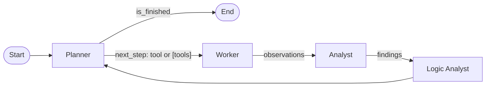

<div align="center">


# Watchtower

**AI-powered penetration testing automation, orchestrated by LLM agents.**

[](https://github.com/fzn0x/watchtower/actions/workflows/ci.yml)
[](https://fzn0x.github.io/watchtower/)
[](https://opensource.org/licenses/MIT)
[](https://www.python.org/downloads/)
[](https://langchain-ai.github.io/langgraph/)
[]()

[Documentation](https://fzn0x.github.io/watchtower/) ·
[Quick Start](#quick-start) ·
[How it works](#how-it-works) ·
[Models](#llm-providers) ·
[Tools](#integrated-tools) ·
[CLI reference](#cli-reference) ·
[Troubleshooting](#troubleshooting)

</div>

---

**Watchtower** is an AI-powered penetration testing automation CLI. It uses LLMs and [LangGraph](https://langchain-ai.github.io/langgraph/) to run an agentic loop against a website or host you are authorized to test: an LLM decides which security tool to run next, Watchtower runs it, another LLM pass reads the raw output and extracts real findings, and everything is stored per run in SQLite so you can export a PDF report at the end.

> [!WARNING]
> Penetration testing is a red-team activity and must only be performed with explicit permission. Watchtower does **not** enforce target scope. Read the [Legal Disclaimer](#legal-disclaimer) before you begin.

## Table of contents

- [Features](#features)
- [How it works](#how-it-works)
- [Requirements](#requirements)
- [Quick Start](#quick-start)
- [Installation in detail](#installation-in-detail)
- [Running with Docker](#running-with-docker)
- [LLM providers](#llm-providers)
- [Usage](#usage)
- [CLI reference](#cli-reference)
- [Environment variables](#environment-variables)
- [Integrated tools](#integrated-tools)
- [Run history and reports](#run-history-and-reports)
- [Project structure](#project-structure)
- [Development](#development)
- [Known limitations](#known-limitations)
- [Troubleshooting](#troubleshooting)
- [Roadmap](#roadmap)
- [Contributing, security, license](#contributing)
- [Legal Disclaimer](#legal-disclaimer)

## Features

- **Multi-agent architecture**: a Planner picks the next tools, a Worker runs them (in parallel when asked), an Analyst turns every tool's output into structured findings, and a Logic Analyst looks for business-logic and IDOR risk.
- **28 integrated security tools** across port scanning, web fingerprinting, crawling and URL discovery, subdomain and DNS enumeration, vulnerability scanning, TLS analysis, content discovery, parameter and API discovery, XSS and SQL injection, and secret scanning.
- **You choose the toolbox**: an interactive checklist (installed tools pre-ticked) decides which tools the AI may use. The planner cannot run anything outside that list.
- **Parallel reconnaissance**: the planner can return several tools for one step; the worker runs up to 5 at a time.
- **Smart truncation**: long tool output is cut down to the lines that matter before it reaches the model, which keeps prompts small and cheap.
- **Authenticated testing** with `--cookie` and repeatable `--header` flags.
- **Run history in SQLite** (`pentest_memory.db`) with per-run PDF reports.
- **LLM-agnostic**: OpenAI, Gemini, OpenRouter, Claude (API key, gateway token, or `ant auth login`), LiteLLM, any OpenAI-compatible endpoint, or local models through Ollama, LM Studio, llama.cpp, and vLLM.
- **Reasoning controls**: opt-in flagship models (`--flagship`), reasoning effort (`--effort`), and output budget (`--max-tokens`), clamped per provider so an unsupported level never crashes a run.
- **Structured output without native JSON mode**: every agent uses Pydantic schemas parsed from plain text, so it also works with free and open-source models that lack tool calling or JSON mode.

## How it works

Watchtower compiles a LangGraph state machine with four nodes and runs it until the planner decides the test is finished (or the graph hits its recursion limit of 100 steps).



| Node | File | What it does |
| --- | --- | --- |
| **Planner** | [`watchtower/agents/planner.py`](watchtower/agents/planner.py) | Sees the target (and whether it is an IP or a hostname), the allowed tools, all findings so far, and the last 3 observations. Returns an updated plan, the next tool or list of tools, and whether the test is finished. Any model error ends the run cleanly. |
| **Worker** | [`watchtower/agents/worker.py`](watchtower/agents/worker.py) | Imports `watchtower.tools.<name>` and calls its `run(target, auth_metadata=...)`. Tools that are not in the allowed list are silently dropped. Several tools run in a thread pool (max 5). |
| **Analyst** | [`watchtower/agents/analyst.py`](watchtower/agents/analyst.py) | Reviews the output of every tool from the latest step and returns findings with `title`, `severity` (Critical, High, Medium, Low, Info), `description`, and `evidence`. False positives and plain tool errors should produce an empty list. |
| **Logic Analyst** | [`watchtower/agents/logic_analysis.py`](watchtower/agents/logic_analysis.py) | Runs only when the latest step included a recon tool (`httpx`, `kiterunner`, `arjun`, `gobuster`, `ffuf`, `katana`, `gau`). Produces an "IDOR Logic Analysis Plan" finding with a 1 to 10 confidence score, business impact, high-risk endpoints, and a step-by-step token and user-ID swapping test plan. |

The shared state ([`watchtower/core/state.py`](watchtower/core/state.py)) carries the scope target, allowed tools, accumulated `observations` and `findings`, the latest step's observations, the current plan, the next step, auth metadata, and the `is_finished` flag. As the graph streams, [`watchtower/main.py`](watchtower/main.py) writes every observation and finding to SQLite under the current run id.

## Requirements

| Requirement | Notes |
| --- | --- |
| Python 3.10 or newer | CI tests 3.10, 3.11, 3.12, and 3.13. |
| Linux or macOS for the tools | Windows works through WSL2. The Python CLI itself starts on Windows, but most scanners do not. |
| An LLM | A hosted provider key, a Claude sign-in, or a local model (Ollama, LM Studio, llama.cpp, vLLM). |
| The security tools | Installed with `install_tools.sh` or bundled in the Docker image. Missing tools are reported and left out of headless runs. |

`install_tools.sh` supports Debian, Ubuntu, and Kali (apt), Fedora, RHEL, and CentOS (dnf), and Arch and Manjaro (pacman). It installs Go when needed and builds the Go-based tools.

## Quick Start

```bash
git clone https://github.com/fzn0x/watchtower.git
cd watchtower

sudo ./install_tools.sh          # installs the security tools
python -m venv venv
source venv/bin/activate         # On Windows: venv\Scripts\activate
pip install -r requirements.txt

cp .env.example .env             # then set a provider key, or see LLM providers below
python -m watchtower.main -t https://www.example.com
```

When the run ends, export it as a PDF:

```bash
python -m watchtower.main --report pentest_report.pdf
```

## Installation in detail

1. **Clone the repository** and enter it.
2. **Install the tools** with `sudo ./install_tools.sh`. It installs system packages, Go, Go-based tools (ProjectDiscovery's `httpx`, `nuclei`, `subfinder`, `katana`, `naabu`, `dnsx`, plus `ffuf`, `gobuster`, `dalfox`, `amass`, `gitleaks`, `gau`, and others), Python and Ruby tools, `testssl.sh`, and `kiterunner` (verified against its release checksums). ProjectDiscovery `httpx` is also linked as `pd-httpx` so it is not confused with Python's `httpx` command.
3. **Create a virtual environment** and `pip install -r requirements.txt`. Key dependencies: `langgraph`, `langchain` (core, community, openai, anthropic, google-genai), `anthropic>=0.98.0`, `litellm`, `pydantic`, `fpdf2`, `questionary`, `python-dotenv`.
4. **Configure an LLM** by copying `.env.example` to `.env` and filling in one provider (see [LLM providers](#llm-providers)).
5. **Check the install** with `python -m watchtower.main --version`. At the start of a real run Watchtower logs any tools it could not find on `PATH`.

A `Makefile` wraps the common commands:

| Command | Does |
| --- | --- |
| `make install` | `pip install -r requirements.txt` |
| `make test` | Runs the unit test suite |
| `make run TARGET=https://example.com` | Starts a run against `TARGET` |
| `make docker-build` / `make docker-up` / `make docker-down` | Docker Compose build, start, stop |

## Running with Docker

The image (`python:3.11-slim`) installs every supported tool through the same `install_tools.sh`, so the container and a local install stay in sync. The tool layer is cached, so code changes do not reinstall the tools.

```bash
cp .env.example .env    # add your provider settings
docker compose build
docker compose run --rm agentic-pentest \
  python -m watchtower.main -t https://www.example.com --skip-ask-tools
```

`docker-compose.yml` mounts the project at `/app`, so `pentest_memory.db` and generated PDFs land in your working copy. To use Ollama running on the host from inside the container, set `OLLAMA_BASE_URL` (for example `http://host.docker.internal:11434/v1`).

## LLM providers

Watchtower runs on hosted models or on a model on your own machine. With no `--provider`, it picks the first provider it finds credentials for, in this order:

1. `OPENROUTER_API_KEY` (model from `OPENROUTER_MODEL_NAME`, default `anthropic/claude-sonnet-5.5`)
2. `OPENAI_API_KEY` (model from `OPENAI_MODEL_NAME`, default `gpt-5.6`)
3. `GEMINI_API_KEY` (model from `GEMINI_MODEL_NAME`, default `gemini-3.8-flash`)
4. Claude credentials (model from `ANTHROPIC_MODEL_NAME`, default `claude-sonnet-5-5`)

If none is found, the run stops before any tool runs with a message listing your options. Model names change often; set the `*_MODEL_NAME` variables to a model your provider currently offers.

### Claude

Set `ANTHROPIC_API_KEY` in `.env`, or sign in once with the [Anthropic CLI](https://github.com/anthropics/anthropic-cli) and skip the key:

```bash
ant auth login
python -m watchtower.main -t https://www.example.com
```

Watchtower lets the Anthropic SDK find the credential itself, in its documented order: `ANTHROPIC_API_KEY`, `ANTHROPIC_AUTH_TOKEN` (for a gateway or proxy, together with `ANTHROPIC_BASE_URL`), the profile named by `ANTHROPIC_PROFILE`, workload identity federation (for CI), then the active `ant auth login` profile. `--provider claude` is an alias for `--provider anthropic`. The default model is `claude-sonnet-5-5`, and `--flagship` switches to `claude-opus-5-5`. Claude Pro and Max subscriptions cannot be used: Anthropic does not allow third-party tools to offer claude.ai login.

### Ollama and other local models

Run the model locally, so prompts and findings never leave your machine:

```bash
ollama pull llama3.3
python -m watchtower.main -t https://www.example.com --provider ollama --model llama3.3
```

No API key is needed. Set `OLLAMA_BASE_URL` if Ollama is not at `http://localhost:11434/v1`. LM Studio, llama.cpp, vLLM, and other OpenAI-compatible servers work by URL:

```bash
python -m watchtower.main -t https://www.example.com --provider http://localhost:1234/v1 --model qwen3-14b
```

Local and URL providers **require** `--model`. Without `--apikey`, Watchtower sends a placeholder key so your `OPENAI_API_KEY` is never leaked to a third-party endpoint. Give the model a large enough context window: the planner prompt includes all findings and recent tool output.

### OpenAI, Gemini, OpenRouter, LiteLLM, and custom endpoints

| `--provider` | Backed by | Key |
| --- | --- | --- |
| `openai` | `ChatOpenAI` | `--apikey OPENAI_API_KEY` |
| `openrouter` | `ChatOpenAI` at `https://openrouter.ai/api/v1` | `--apikey OPENROUTER_API_KEY` |
| `anthropic` / `claude` | Anthropic SDK sign-in | optional `--apikey` |
| `litellm` | `ChatLiteLLM` | `--apikey <VAR>` |
| `ollama` | `ChatOpenAI` at `OLLAMA_BASE_URL` | none |
| `http(s)://...` | `ChatOpenAI` at that URL | optional `--apikey <VAR>` |
| any other name (e.g. `groq`) | LangChain `init_chat_model`, falling back to LiteLLM | `--apikey <VAR>` |

`--apikey` takes the **name** of an environment variable, not the key itself, so secrets stay out of your shell history:

```bash
export GROQ_API_KEY=...
python -m watchtower.main -t https://www.example.com --provider groq --model llama-3.3-70b --apikey GROQ_API_KEY
```

### Flagship models and reasoning

| Flag | Effect |
| --- | --- |
| `--flagship` | Uses the provider's top model (`gpt-6-astra`, `claude-opus-5-5`, `anthropic/claude-opus-5.5` on OpenRouter, `gemini-4-carbon`) with reasoning at `high` effort. |
| `--effort low\|medium\|high\|xhigh\|max` | Sets reasoning effort. If a provider does not accept a level, it is lowered to the highest one it does accept, with a one-time warning (Claude accepts all five; Gemini up to `high`; most others `low` to `high`). |
| `--max-tokens N` | Caps output tokens. With reasoning on and no cap, the default is 16000. |

When reasoning is on, temperature is not sent (reasoning models reject it). Without reasoning, temperature is `0` for deterministic output, except on Claude, which rejects any temperature.

## Usage

### Interactive run

```bash
python -m watchtower.main -t https://www.example.com
```

You get a checklist of all 28 tools with the installed ones pre-ticked. The tools you leave ticked are the only ones the planner may use. Then the agent loop starts and logs every node it executes and every state update.

### Headless run (CI, scripts, Docker)

```bash
python -m watchtower.main -t https://www.example.com --skip-ask-tools
```

Skips the checklist and allows every tool that is installed. If the interactive prompt cannot start (no TTY), Watchtower also falls back to the installed tools.

### Authenticated testing

```bash
python -m watchtower.main -t https://app.example.com \
  --cookie "session=abc123" \
  --header "Authorization: Bearer eyJ..." \
  --header "X-Tenant: acme"
```

`--header` takes `Key:Value` and can be repeated. See [Known limitations](#known-limitations) for which tools currently receive these values.

### Target formats

`-t` accepts a full URL (`https://example.com/app`), a bare domain (`example.com`), or an IPv4 address (`192.168.0.10`). Each tool receives the form it needs: host and DNS tools get the bare hostname (scheme, port, path, and credentials stripped), web tools get a full URL (`https://` added if missing). The secret scanners (`gitleaks`, `trufflehog`) only do something useful when the target is a git repository URL, such as `https://github.com/owner/repo`; otherwise they skip with a clear message.

## CLI reference

```
python -m watchtower.main [options]
```

| Option | Description |
| --- | --- |
| `-t, --target TARGET` | Target URL, domain, or IP. Required unless you use `--report`. |
| `--skip-ask-tools` | Do not show the tool checklist; allow every installed tool. |
| `--provider NAME_OR_URL` | `openai`, `anthropic` / `claude`, `openrouter`, `litellm`, `ollama`, an OpenAI-compatible URL, or another LangChain provider name. |
| `--model MODEL` | Model id for `--provider`. Required for `ollama` and URL providers. |
| `--apikey ENV_VAR` | Name of the environment variable that holds the API key. |
| `--cookie COOKIE` | Session cookie for authenticated requests. |
| `--header Key:Value` | Extra request header. Repeatable. |
| `--flagship` | Use the provider's flagship model with reasoning at high effort. |
| `--effort LEVEL` | Reasoning effort: `low`, `medium`, `high`, `xhigh`, `max`. |
| `--max-tokens N` | Maximum output tokens for the model. |
| `--report FILE` | Write a PDF report from `pentest_memory.db` and exit (`.pdf` is appended if missing). |
| `--run RUN_ID` | With `--report`, report on this run instead of the most recent one. |
| `--version` | Print the version and exit. |

## Environment variables

Put these in `.env` (loaded automatically) or export them. See [`.env.example`](.env.example).

| Variable | Purpose |
| --- | --- |
| `OPENAI_API_KEY`, `OPENAI_MODEL_NAME` | OpenAI key and model. |
| `GEMINI_API_KEY`, `GEMINI_MODEL_NAME` | Google Gemini key and model. |
| `OPENROUTER_API_KEY`, `OPENROUTER_MODEL_NAME` | OpenRouter key and model. |
| `ANTHROPIC_API_KEY`, `ANTHROPIC_MODEL_NAME` | Claude key and model. |
| `ANTHROPIC_AUTH_TOKEN`, `ANTHROPIC_BASE_URL` | Claude through a gateway or proxy. |
| `ANTHROPIC_PROFILE`, `ANTHROPIC_FEDERATION_RULE_ID` | A named `ant` profile, or workload identity federation. |
| `WATCHTOWER_PROVIDER`, `WATCHTOWER_MODEL`, `WATCHTOWER_APIKEY_NAME` | Same as `--provider`, `--model`, `--apikey`. |
| `WATCHTOWER_FLAGSHIP`, `WATCHTOWER_EFFORT`, `WATCHTOWER_MAX_TOKENS` | Same as `--flagship`, `--effort`, `--max-tokens`. |
| `OLLAMA_BASE_URL` | Ollama endpoint (default `http://localhost:11434/v1`). |
| `WATCHTOWER_WORDLIST` | Wordlist for `ffuf` and `gobuster`. Default: the first SecLists or dirb `common.txt` found on the system, then a small bundled list. |
| `WATCHTOWER_HTTPX_BIN` | Path to ProjectDiscovery's `httpx`, if Python's `httpx` command shadows it on `PATH`. |

## Integrated tools

Every tool has a small wrapper in [`watchtower/tools/`](watchtower/tools/) that builds the command below and runs it with a 5-minute timeout. `<host>` is the bare hostname or IP, `<url>` a full URL.

| Category | Tool | Command Watchtower runs |
| --- | --- | --- |
| Ports and services | `nmap` | `nmap -sV -sC -A -Pn -T4 <host>` |
| | `masscan` | `masscan -p1-65535 --rate 1000 <host>` |
| | `naabu` | `naabu -host <host> -top-ports 1000 -silent -nc` |
| Web fingerprinting | `httpx` (ProjectDiscovery) | `httpx -u <url> -silent -nc -sc -title -td -server -cl -fr` |
| | `whatweb` | `whatweb -a 3 <url>` |
| | `wafw00f` | `wafw00f -a <url>` |
| | `cmseek` | `cmseek -u <url> --batch --random-agent` |
| Crawling and URLs | `katana` | `katana -u <url> -silent -nc -d 2 -jc -timeout 10 -rl 50` |
| | `gau` | `gau <host> --providers wayback,commoncrawl,otx,urlscan ...` |
| Subdomains and DNS | `subfinder` | `subfinder -d <host> -silent -all` |
| | `amass` | `amass enum -passive -d <host>` |
| | `dnsrecon` | `dnsrecon -d <host>` |
| | `dnsx` | `dnsx -silent -nc -a -aaaa -cname -mx -ns -txt -resp` (host on stdin) |
| Vulnerability scanning | `nuclei` | `nuclei -u <url> -silent` |
| | `nikto` | `nikto -h <url> -maxtime 5m` |
| | `wpscan` | `wpscan --url <url> --no-banner --random-user-agent --enumerate vp,vt,tt,cb,dbe,u,m` |
| | `retire` | `retire --site <url> --outputformat text` |
| Injection and XSS | `sqlmap` | `sqlmap -u <url> --batch --random-agent --level=2 --risk=2 --crawl=2` |
| | `xsstrike` | `xsstrike -u <url>` |
| | `dalfox` | `dalfox url <url> --silence --skip-bav` |
| TLS | `testssl` | `testssl.sh --quiet <host>` |
| | `sslyze` | `sslyze <host>` |
| Content discovery | `gobuster` | `gobuster dir -u <url> -w <wordlist>` |
| | `ffuf` | `ffuf -u <url>/FUZZ -w <wordlist> -t 40 -c` |
| Parameters and APIs | `arjun` | `arjun -u <url> -t 10 -T 5` |
| | `kiterunner` | `kr scan <url> -A=apiroutes-2202` |
| Secrets (git repos) | `gitleaks` | shallow `git clone`, then `gitleaks detect --source <clone> -v` |
| | `trufflehog` | `trufflehog git <repo> --results=verified,unknown --json --no-update` |

Some of these (`sqlmap` at level and risk 2, `masscan` across all 65535 ports, `nmap -A`, `wpscan` user enumeration) are intrusive and noisy. Untick them in the checklist when the engagement does not allow active exploitation or heavy scanning.

### Output truncation

Output above 5000 characters is shortened before it reaches the model. If more than 20 lines contain a security keyword (`vulnerability`, `critical`, `[+]`, `finding`, `exposed`, `error`, `warning`), the first 50 of those lines are kept. Otherwise the first and last 2500 characters are kept. The truncated text is also what is stored in the database.

## Run history and reports

Every run gets an id such as `20261123-141502-a1b2c3` and is stored in `pentest_memory.db` in the current directory, in three tables:

| Table | Contents |
| --- | --- |
| `runs` | `run_id`, `target`, `created_at` |
| `observations` | Raw (truncated) output of every tool, per run |
| `findings` | Every Analyst and Logic Analyst finding, with full details as JSON |

Generate a report:

```bash
python -m watchtower.main --report report.pdf                         # most recent run
python -m watchtower.main --report report.pdf --run 20261123-141502-a1b2c3
```

The PDF has an executive summary (run id, target, start time, number of findings) followed by one section per finding with a color-coded severity, target, description, and evidence. Databases created by older versions are migrated automatically.

You can also query the database directly:

```bash
sqlite3 pentest_memory.db "SELECT run_id, target, created_at FROM runs ORDER BY created_at DESC;"
```

## Project structure

```
watchtower/
├── main.py                  CLI entry point: flags, tool selection, graph loop, persistence
├── agents/
│   ├── planner.py           Planner node and get_llm() provider selection
│   ├── worker.py            Runs tool wrappers, in parallel when asked
│   ├── analyst.py           Turns tool output into structured findings
│   └── logic_analysis.py    IDOR and business-logic analysis
├── core/
│   ├── agent_manager.py     Builds the LangGraph state machine
│   ├── state.py             Shared AgentState definition
│   ├── llm_config.py        Provider checks, flagship models, effort clamping
│   ├── claude.py            Claude model that uses the Anthropic SDK's own sign-in
│   ├── binaries.py          Tool detection, including the httpx name clash
│   ├── targets.py           Hostname and URL normalization, git repo detection
│   ├── guardrails.py        Target format validation
│   ├── memory.py            SQLite run store
│   └── wordlists.py         Wordlist resolution for ffuf and gobuster
├── tools/                   One wrapper per tool, plus runner.py (subprocess + truncation)
├── reporting/reporter.py    PDF report generation (fpdf2)
└── data/common.txt          Bundled fallback wordlist
tests/                       unittest suite (agents, tools, providers, memory, targets, ...)
docs/                        Documentation site (Next.js + Fumadocs)
scripts/                     Release-notes and Docker image verification helpers
install_tools.sh             Installs every supported tool
Dockerfile, docker-compose.yml
```

## Development

Run the test suite (no tools or API keys needed; external calls are mocked):

```bash
make test
# or
python -m unittest discover -s tests -v
```

CI ([`.github/workflows/ci.yml`](.github/workflows/ci.yml)) runs the tests on Python 3.10 to 3.13, checks that the CLI starts, checks that `install_tools.sh` is valid bash, and rejects em-dashes in tracked text. Changes to the Dockerfile, installer, or requirements also build the Docker image and verify every tool inside it. Releases are published from version tags, with notes taken from [`CHANGELOG.md`](CHANGELOG.md).

### Adding a tool

1. Create `watchtower/tools/<tool>.py` with a `run(target, **kwargs)` function. Use `extract_hostname` for host and DNS tools and `normalize_url` for web tools, and pass `auth_metadata` to `run_cli_tool`.
2. Add the name to `ALL_TOOLS` in [`watchtower/tools/__init__.py`](watchtower/tools/__init__.py). The Worker imports tool modules by name, so it needs no change.
3. If the binary on `PATH` has a different name, add it to `BINARY_ALIASES` in [`watchtower/core/binaries.py`](watchtower/core/binaries.py) (see `kiterunner` / `kr`).
4. Add install steps to `install_tools.sh` so local installs and the Docker image both get it.
5. Add tests and list the tool in this README and the docs.

### Adding an agent

1. Create a module in `watchtower/agents/` with a node function that takes `AgentState` and returns a partial state update.
2. Define its output as a Pydantic model and parse it with `PydanticOutputParser`, as the existing agents do.
3. Wire it into the graph in [`watchtower/core/agent_manager.py`](watchtower/core/agent_manager.py).

`findings`, `observations`, and `messages` use additive reducers: return only **new** items from a node, never the existing list, or every item gets duplicated.

### Documentation site

```bash
cd docs
npm install
npm run dev
```

The docs build fails on a broken internal link or anchor.

## Known limitations

- **No scope enforcement.** Target validation only checks the format. Nothing stops you from pointing Watchtower at a system you are not authorized to test.
- **Single target per run.** The state holds a list, but the worker always uses the first target.
- **Auth headers reach only some tools.** `--cookie` and `--header` are currently injected into ProjectDiscovery `httpx` (as `-H`) and `sqlmap` (as `--cookie` / `--headers`). Other tools run unauthenticated.
- **LLM output is not ground truth.** Findings can be wrong or hallucinated. Verify every finding by hand before reporting it.
- **Fixed tool settings.** Each tool runs with the command shown above and a 5-minute timeout; there is no per-tool configuration yet.
- **Local database.** `pentest_memory.db` is created in the directory you run from, and it holds raw tool output. Treat it as sensitive.

## Troubleshooting

| Symptom | Fix |
| --- | --- |
| `No LLM provider is configured` | Set a provider key in `.env`, run `ant auth login`, or pass `--provider ollama --model <name>`. |
| `--provider ollama needs a model name` | Add `--model`, or set `WATCHTOWER_MODEL`. |
| `httpx skipped: ProjectDiscovery httpx was not found` | Python's `httpx` command is shadowing the scanner. Run `install_tools.sh` (it adds `pd-httpx`) or set `WATCHTOWER_HTTPX_BIN`. |
| `Missing tools: ...` at start-up | Those binaries are not on `PATH`. Run `sudo ./install_tools.sh`, or use the Docker image. Go tools live in `~/go/bin`. |
| The run ends right away with `current_plan: Error: ...` | The model call failed (bad key, wrong model name, context too small). The error text says which. |
| Local model returns invalid JSON | Use a larger or instruction-tuned model and give it a bigger context window. |
| `gitleaks` / `trufflehog` skipped | They only scan git repositories. Use a repository URL as the target. |
| `No pentest findings were found` when reporting | The run produced no findings, or `--run` points to a different run. List runs with the `sqlite3` command above. |

More in the [troubleshooting guide](https://fzn0x.github.io/watchtower/troubleshooting/).

## Roadmap

- [x] Initial LangGraph Planner/Worker architecture.
- [x] Integrate core web and network reconnaissance tools.
- [x] Add Pydantic structured-output fallback for open-source OpenRouter models.
- [x] Parallel tool execution and smart truncation.
- [x] Support for authenticated pentesting (cookies / headers).
- [x] Flagship model support with reasoning-aware configuration.
- [x] Claude sign-in with an API key, `ant auth login`, or a gateway token.
- [x] Local models through Ollama and any OpenAI-compatible server.
- [x] Continuous integration, verified Docker image, and a documentation site.
- [ ] Advanced business-logic analysis enhancements.

## Contributing

Contributions are welcome! See [CONTRIBUTING.md](CONTRIBUTING.md), the [Development](#development) section above, and the [development guide](https://fzn0x.github.io/watchtower/development/).

Watchtower does not enforce target scope. You are responsible for testing only systems you own or are explicitly authorized to assess.

## Security

Found a security issue in Watchtower itself? Please follow the [Security Policy](SECURITY.md) and report it privately through GitHub's **Report a vulnerability** button, not in a public issue.

## License

Licensed under the **MIT License**. See [`LICENSE`](LICENSE) for details.

By using this software, you agree to the conditions outlined in the [Legal Disclaimer](#legal-disclaimer). Watchtower's developers assume no liability for misuse of this tool.

## Legal Disclaimer

**Watchtower is designed exclusively for authorized security testing and educational purposes.**

- **Legal use:** authorized penetration testing, security research, educational environments.
- **Illegal use:** unauthorized access, malicious activity, any form of cyber attack.

You are fully responsible for ensuring you have explicit written permission before testing any system. Unauthorized access to computer systems is illegal under laws including the Computer Fraud and Abuse Act (CFAA), the UK Computer Misuse Act, and equivalent legislation in other countries.

By using Watchtower, you agree to use it only on systems you own or are explicitly authorized to test.

## Acknowledgements

Created and maintained by **[fzn0x](https://github.com/fzn0x)**.

A deep and sincere thank you to the open-source security community. Watchtower stands on the shoulders of giants. This framework would not exist without the developers who built and maintain the underlying penetration testing and reconnaissance tools that power its worker engine. Thank you for making security accessible.
